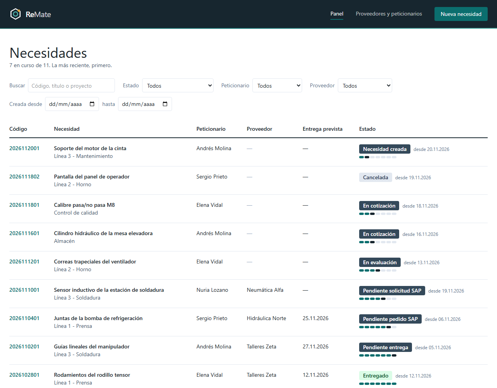
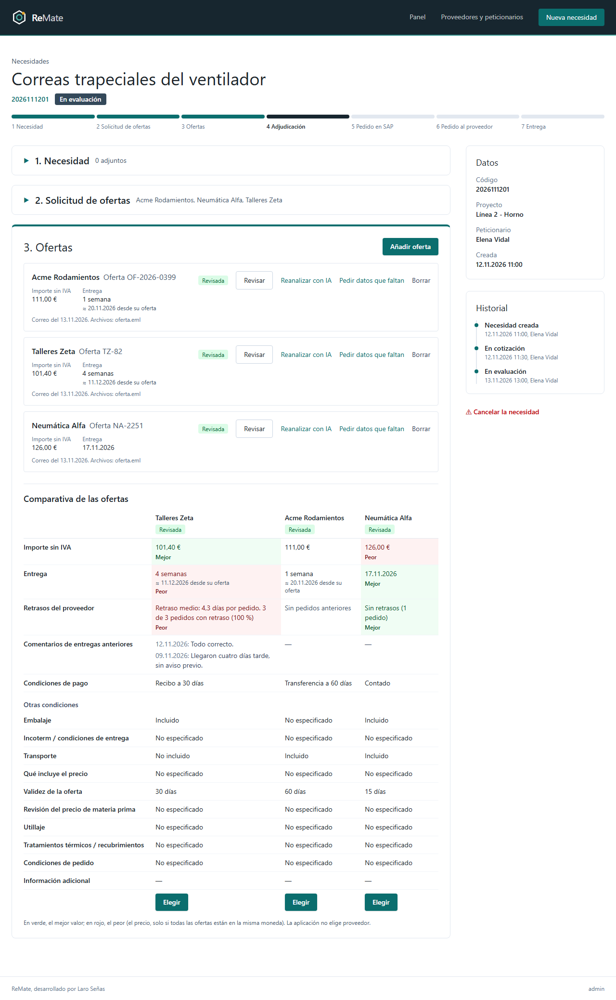
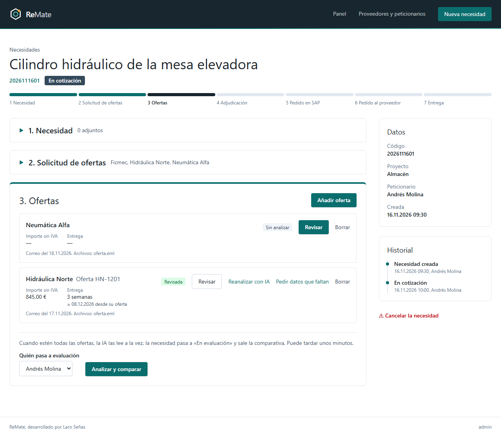
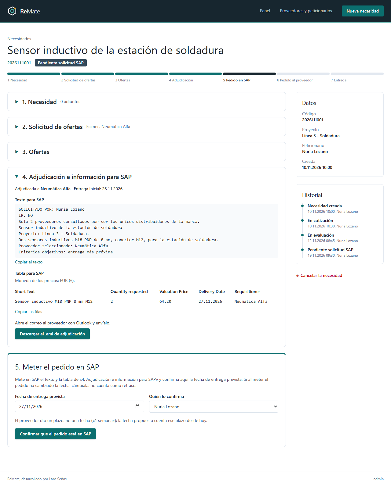
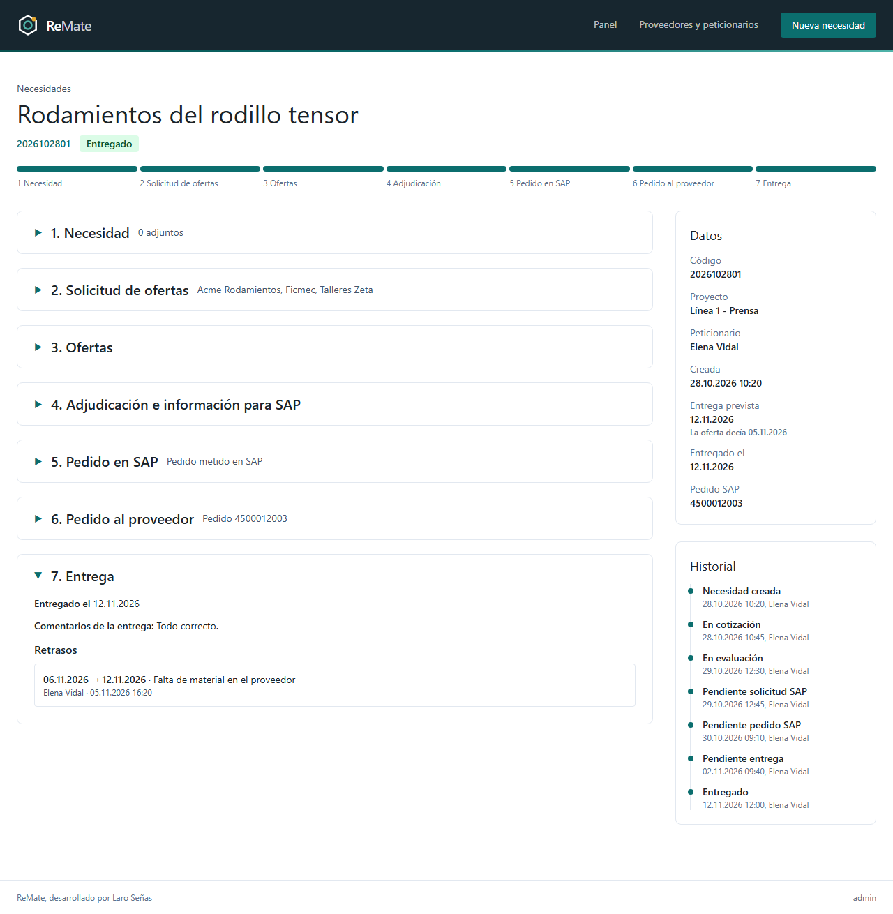
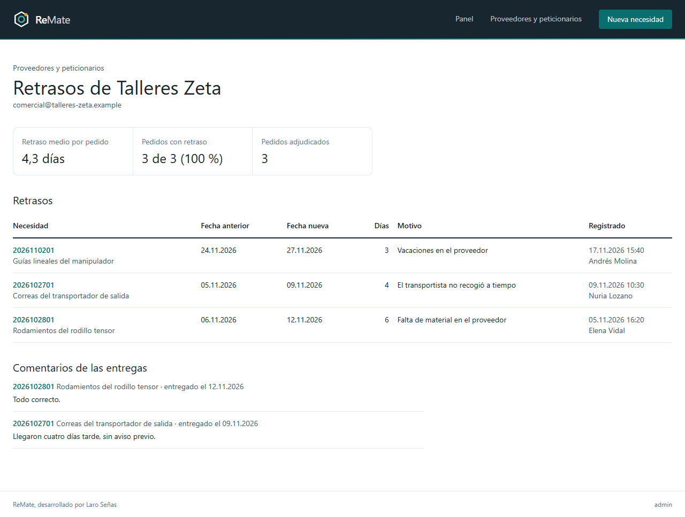
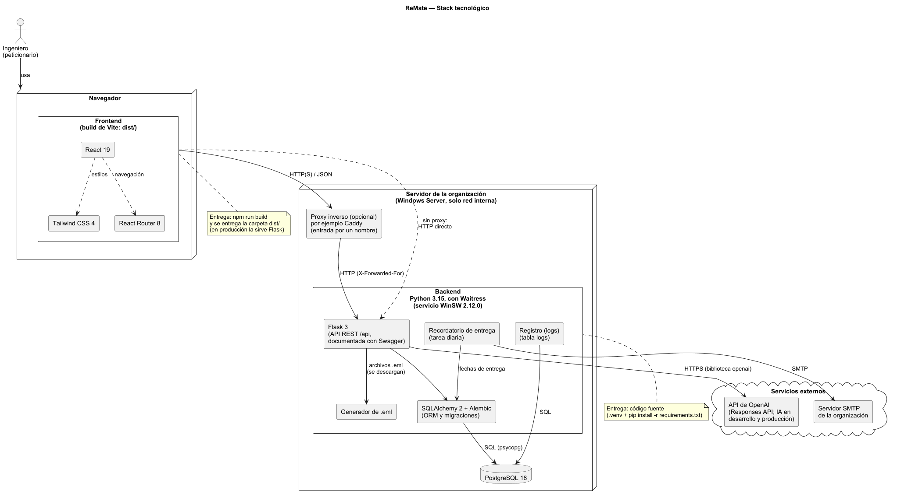

# ReMate

[English](README.md) · **Español**

[](https://github.com/larosenas/ReMate/actions/workflows/ci.yml)
[](LICENSE)

ReMate es una aplicación web que desarrollé en solitario durante mis prácticas, para el departamento de ingeniería de una empresa industrial, donde funciona en producción. Gestiona la compra de utillaje y repuestos, desde que alguien avisa de una pieza rota hasta que se recibe el pedido.

La hice de principio a fin: análisis de requisitos, diseño, desarrollo, pruebas, despliegue y documentación.

**788** pruebas de backend y **199** de frontend · **92 %** de cobertura en el backend · **10** casos de uso · **16** registros de decisiones de arquitectura

Sustituye un proceso hecho con correos, hojas de cálculo y memoria por un único flujo guiado de siete pasos. La IA lee las ofertas de los proveedores y redacta correos, pero **la IA solo propone: el ingeniero revisa los datos y elige el proveedor.**



## El flujo

Cada compra (una *necesidad*) pasa por siete pasos, y su estado se ve siempre en el panel:

1. **Necesidad.** El ingeniero anota qué hace falta, para qué proyecto y quién lo pide, y adjunta planos o fotos. ReMate le asigna un código (`AAAAMMDDNN`).
2. **Solicitud de ofertas.** El ingeniero elige los proveedores de la lista. ReMate prepara un correo listo para enviar (`.eml`), con los proveedores en copia oculta y los adjuntos, para abrirlo y enviarlo desde el programa de correo de siempre.
3. **Ofertas.** Se suben las respuestas de los proveedores (`.eml` o `.msg` de Outlook, con adjuntos en PDF, Word o Excel). La IA extrae el número de oferta, los precios, el plazo de entrega y las condiciones de pago, y el ingeniero los revisa. Si falta algún dato, la IA redacta un correo para pedírselo al proveedor. Después, ReMate monta la comparativa: precio sin IVA, plazo, condiciones y retrasos anteriores del proveedor, con el mejor y el peor valor marcados.
4. **Adjudicación.** El ingeniero elige un proveedor. ReMate prepara el texto y la tabla de líneas para la solicitud de pedido en el ERP (SAP), y el correo para el proveedor elegido.
5. **Pedido en el ERP.** El ingeniero confirma que el pedido ya está en el ERP y fija la fecha de entrega prevista. Las personas que deben enterarse reciben un correo.
6. **Pedido al proveedor.** El ingeniero adjunta el pedido oficial y ReMate prepara el correo para el proveedor, vinculado a su número de oferta.
7. **Entrega.** Los retrasos se registran con su motivo. Una semana antes de la fecha prevista, el peticionario recibe un correo de recordatorio. Cuando llegan las piezas, el ingeniero confirma la entrega y puede dejar un comentario sobre el proveedor.

Una necesidad se puede cancelar en cualquier paso antes de la entrega, con un motivo, y se conserva su historial.



| Revisión de una oferta leída por la IA | Texto y líneas para la solicitud de pedido en el ERP |
| --- | --- |
|  |  |
| **Necesidad entregada, con su historial** | **Histórico de retrasos de un proveedor** |
|  |  |

Más capturas en el [manual de usuario](documentacion/manual-de-usuario.md). Todos los datos que se ven son inventados.

### Además

- Panel con búsqueda y filtros por estado, peticionario, proveedor y fecha, e histórico de retrasos de cada proveedor.
- Listas de proveedores y peticionarios, que se editan en la aplicación o se cargan desde un CSV.
- Cada oferta conserva su moneda, sin conversiones.
- Los archivos de las necesidades cerradas caducan pasado un tiempo, igual que el registro de la aplicación, para que el servidor ocupe poco.
- Modo admin con contraseña, para la persona responsable de la aplicación.
- API REST documentada con OpenAPI (Swagger UI en `/api/docs/swagger`).

## Tecnologías

| Capa | Tecnología |
| --- | --- |
| Frontend | React 19, Tailwind CSS 4 y React Router 8, compilado con Vite |
| Backend | Python 3.15, Flask 3, SQLAlchemy 2, Alembic y flask-openapi3 |
| Base de datos | PostgreSQL 18 |
| IA | API de OpenAI (Responses API) |
| Correo | Archivos `.eml` para el programa de correo del usuario; SMTP solo para los avisos y recordatorios automáticos |
| Producción | Windows Server en una red interna: Waitress como servicio de Windows con WinSW, y el Programador de tareas para la tarea diaria. Opcionalmente, detrás de un proxy inverso como Caddy |
| Calidad | pytest y Vitest con cobertura mínima, pruebas de accesibilidad con axe-core, Ruff y ESLint, un hook previo al commit que busca secretos, y GitHub Actions, que pasa todas las comprobaciones en cada push y pull request |



## Aspectos técnicos destacados

- **La IA propone y las personas deciden.** La IA lee las ofertas y redacta textos, y responde con un esquema JSON fijo. La comparativa se calcula en el código, y cada dato que extrae la IA se puede revisar y corregir antes de elegir proveedor ([ADR 0011](docs/adr/0011-ia-solo-para-leer-ofertas-con-la-api-de-openai.md)).
- **Lector propio de `.msg` de Outlook.** Los `.msg` (archivos compuestos MS-CFB) se leen con un lector escrito solo con la biblioteca estándar de Python, sin paquetes de terceros ([ADR 0013](docs/adr/0013-correos-msg-con-lector-propio.md)). El texto de los adjuntos de Word y Excel se extrae de la misma forma (`zipfile` y `ElementTree`), con límites de tamaño frente a las bombas zip.
- **El gasto de la API, controlado.** Como mucho se hacen 8 llamadas a la IA a la vez en toda la aplicación, cada respuesta tiene un tope de tokens, los adjuntos se recortan antes de enviarlos y una respuesta cortada no se repite, para no pagarla dos veces.
- **Seguridad en una red interna sin login.** Los cambios solo se aceptan desde el propio origen de ReMate, lo que bloquea los formularios enviados desde otras webs, y la cabecera `Host` se compara con una lista de nombres permitidos para frenar el DNS rebinding. El modo admin usa una contraseña guardada como hash, una cookie `HttpOnly` y `SameSite=Strict`, y bloquea durante 15 minutos solo al equipo que falla 5 veces. Detrás de un proxy inverso, la IP del equipo se toma solo del proxy de confianza ([ADR 0015](docs/adr/0015-modo-admin-con-contrasena.md), [ADR 0016](docs/adr/0016-proxy-inverso-con-caddy.md)).
- **Desplegada en Windows Server.** Waitress funciona como servicio de Windows con WinSW, y una tarea diaria envía los recordatorios y borra los archivos y registros caducados ([ADR 0009](docs/adr/0009-servicio-windows-con-winsw.md), [ADR 0014](docs/adr/0014-caducidad-de-archivos-y-copias.md)).
- **Sin tocar el correo del usuario.** Los correos salientes son archivos `.eml` que el ingeniero abre, revisa y envía desde su programa. Solo los recordatorios se envían solos.
- **Decisiones documentadas.** La arquitectura está recogida en [ADR](docs/adr/) y los requisitos en [casos de uso](docs/casos-de-uso/), referenciados desde el código y las pruebas.

## Puesta en marcha (desarrollo)

Requisitos: Python 3.15, Node.js 24 LTS y PostgreSQL 18. La configuración va en un archivo `.env` en la raíz del repositorio. Se copia de [`.env.example`](.env.example), que trae todas las variables con valores de ejemplo inventados. Para leer ofertas hace falta una clave de la API de OpenAI (`IA_API_KEY`). Las pruebas no llaman a la API real.

```powershell
# Backend, dentro de backend/
py -3.15 -m venv .venv            # Linux: python3.15 -m venv .venv
.\.venv\Scripts\Activate.ps1      # Linux: source .venv/bin/activate
pip install -r requirements-dev.txt
alembic upgrade head              # crea o actualiza las tablas
flask --app app run               # API en http://127.0.0.1:5000/api

# Frontend, dentro de frontend/ (en otra terminal)
npm install
npm run dev                       # interfaz en http://localhost:5173
```

Opcional, una vez por clon: `git config core.hooksPath scripts/hooks` activa la búsqueda de secretos antes de cada commit.

### Pruebas y comprobaciones

```powershell
# Backend, dentro de backend/
pytest --cov                      # usa una base de datos aparte, <DB_NAME>_test
ruff check .
ruff format --check .

# Frontend, dentro de frontend/
npm run test:cobertura
npm run lint
npm run build                     # versión de producción en dist/
```

## Documentación

- **Usuarios:** [manual de usuario](documentacion/manual-de-usuario.md).
- **Instalación:** [guía de instalación paso a paso](documentacion/guia-de-instalacion.md) en Windows Server.
- **Requisitos:** [casos de uso CU-001 a CU-010](docs/casos-de-uso/).
- **Diseño:** [arquitectura](docs/diseno/arquitectura.md), [API REST](docs/diseno/api.md), [modelo de dominio](docs/diseno/modelo-de-dominio.md), [modelo de datos](docs/diseno/modelo-de-datos.md), [estados de una necesidad](docs/diseno/estados-necesidad.md), [guía de estilo visual](docs/diseno/guia-de-estilo.md) y [comparativa de ORM](docs/diseno/dafo-orm-python.md).
- **Decisiones:** [registros de decisiones de arquitectura (ADR)](docs/adr/).
- **Diagramas:** [fuentes PlantUML y cómo regenerarlas](docs/diagramas/README.md).

## Estructura del repositorio

```text
ReMate/
├── backend/        API en Python: app/ (api, servicios, modelos, integraciones), migraciones de Alembic y pruebas
├── frontend/       Interfaz en React: src/ (páginas, componentes, cliente de la API, pruebas)
├── scripts/        Diagramas, auditoría de dependencias, hook de búsqueda de secretos y scripts de Windows
├── docs/           Documentación técnica: casos de uso, ADR, diseño y diagramas
├── documentacion/  Manual de usuario y guía de instalación
└── .env.example    Variables de configuración con valores de ejemplo
```

## Metodología

El proyecto siguió una versión ligera del Proceso Unificado de Rational (RUP): iteraciones cortas, dirigidas por casos de uso y por riesgos, con trazabilidad de cada requisito a su caso de uso, al código y a las pruebas. Este repositorio conserva los artefactos técnicos: casos de uso, ADR, diseño y diagramas.

## Autoría

Laro Señas.

## Licencia

[MIT](LICENSE) © 2026 Laro Señas.

Se agradecen los avisos de errores y los pull requests: consulta [CONTRIBUTING.md](CONTRIBUTING.md), el [código de conducta](CODE_OF_CONDUCT.md) y, para problemas de seguridad, [SECURITY.md](SECURITY.md) (los tres en inglés).
