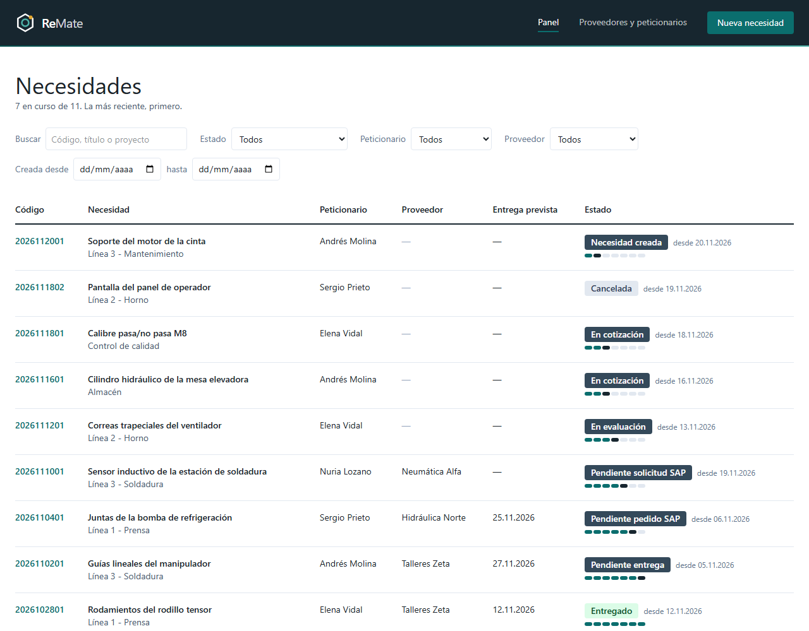
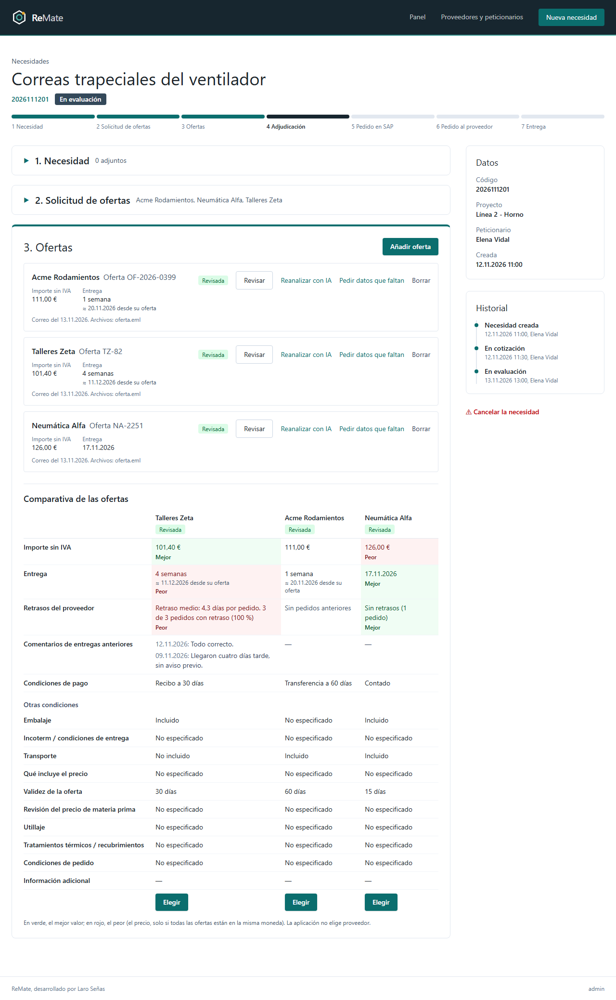
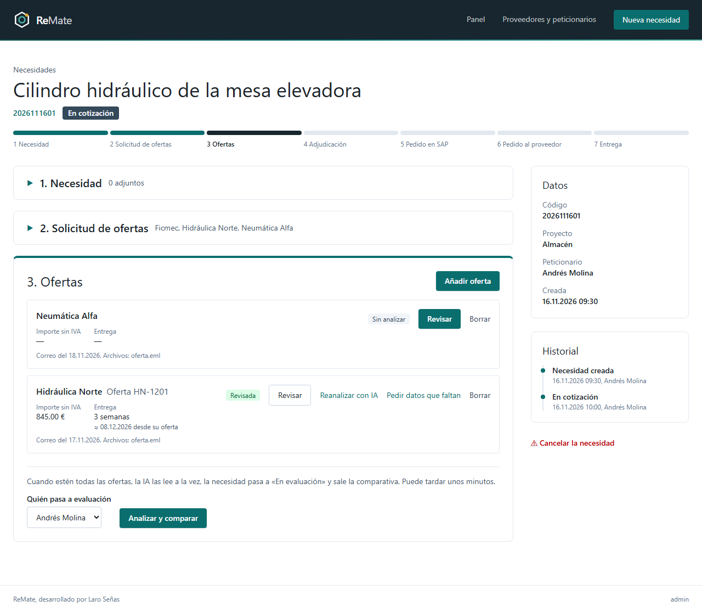
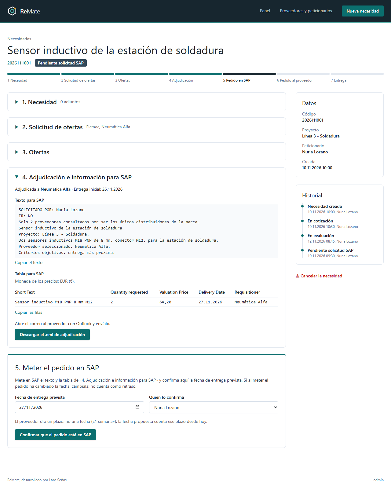
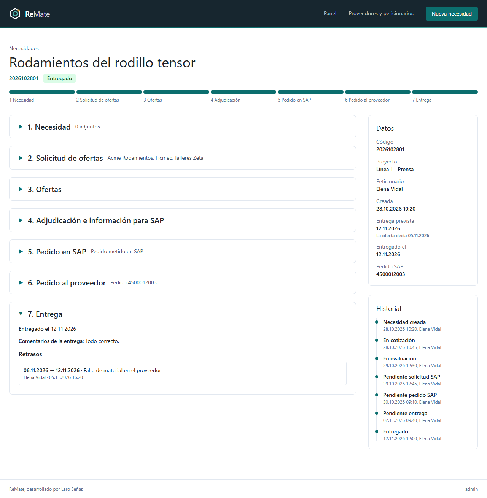
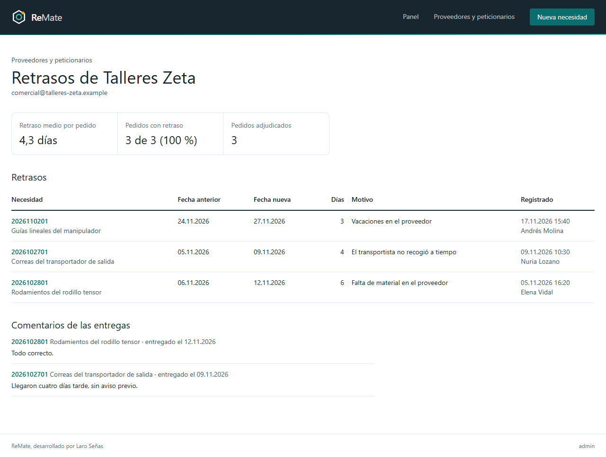
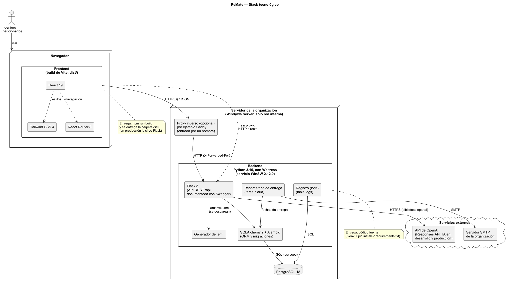

# ReMate

**English** · [Español](README.es.md)

[](https://github.com/larosenas/ReMate/actions/workflows/ci.yml)
[](LICENSE)

ReMate is a web application I built on my own during an internship, for the engineering department of an industrial company, where it runs in production. It manages the purchase of tooling and spare parts, from the moment someone reports a broken part until the order is received.

I took it from start to finish: requirements analysis, design, development, testing, deployment and documentation.

**788** backend tests and **199** frontend tests · **92 %** backend coverage · **10** use cases · **16** architecture decision records

It replaces a process built on email, spreadsheets and memory with one guided, seven-step workflow. AI reads supplier quotes and drafts emails, but **the AI only suggests: the engineer reviews the data and chooses the supplier.**



## The workflow

Each purchase request (a *need*) goes through seven steps, and its status is visible on the dashboard at all times:

1. **Need.** The engineer records what is needed, for which project and who requested it, and attaches drawings or photos. ReMate assigns a code (`YYYYMMDDNN`).
2. **Request for quotes.** The engineer picks suppliers from the list. ReMate generates a ready-to-send email (`.eml`) with the suppliers in BCC and the attachments, to open and send from the usual mail client.
3. **Quotes.** The supplier replies (`.eml` or Outlook `.msg`, with PDF, Word or Excel attachments) are uploaded. The AI extracts the offer number, prices, delivery time and payment terms, and the engineer reviews them. If something is missing, the AI drafts an email asking the supplier for it. ReMate then builds a comparison table: price before tax, delivery time, conditions and the supplier's past delays, with the best and worst values highlighted.
4. **Award.** The engineer chooses a supplier. ReMate prepares the text and the line table for the purchase request in the ERP (SAP), and the email to the chosen supplier.
5. **Order in the ERP.** The engineer confirms that the order exists in the ERP and sets the expected delivery date. The people to notify get an email.
6. **Order to the supplier.** The engineer attaches the official purchase order, and ReMate generates the email to the supplier, linked to their offer number.
7. **Delivery.** Delays are recorded with a reason. One week before the expected date, the requester gets an email reminder. When the parts arrive, the engineer confirms the delivery and can leave a comment about the supplier.

A need can be cancelled at any step before delivery, with a reason, and its history is kept.



| Reviewing a quote read by the AI | Text and lines for the ERP purchase request |
| --- | --- |
|  |  |
| **Delivered need, with its history** | **Supplier delay history** |
|  |  |

More screenshots in the [user manual](documentacion/manual-de-usuario.md) (in Spanish). All the data shown is made up.

### Also included

- Dashboard with search and filters by status, requester, supplier and date, plus the delay history of each supplier.
- Supplier and requester lists, editable in the app or loaded from a CSV file.
- Each quote keeps its own currency, with no conversions.
- Files of closed needs expire after a set time, as does the application log, to keep the server small.
- Admin mode protected by a password, for the person in charge of the application.
- REST API documented with OpenAPI (Swagger UI at `/api/docs/swagger`).

## Tech stack

| Layer | Technology |
| --- | --- |
| Frontend | React 19, Tailwind CSS 4, React Router 8, built with Vite |
| Backend | Python 3.15, Flask 3, SQLAlchemy 2, Alembic, flask-openapi3 |
| Database | PostgreSQL 18 |
| AI | OpenAI API (Responses API) |
| Email | `.eml` files for the user's mail client; SMTP only for automatic notices and reminders |
| Production | Windows Server on an internal network: Waitress run as a Windows service with WinSW, and Task Scheduler for the daily job. Optionally behind a reverse proxy such as Caddy |
| Quality | pytest and Vitest with minimum coverage, axe-core accessibility tests, Ruff and ESLint, a pre-commit hook that scans for secrets, and GitHub Actions running every check on each push and pull request |



## Technical highlights

- **The AI suggests, people decide.** The AI reads quotes and drafts text, and answers in a fixed JSON schema. The comparison is calculated in code, and every value the AI extracts can be checked and corrected before a supplier is chosen ([ADR 0011](docs/adr/0011-ia-solo-para-leer-ofertas-con-la-api-de-openai.md)).
- **Own Outlook `.msg` parser.** `.msg` files (MS-CFB compound files) are read by a parser written only with the Python standard library, with no third-party package ([ADR 0013](docs/adr/0013-correos-msg-con-lector-propio.md)). Text from Word and Excel attachments is extracted the same way (`zipfile` and `ElementTree`), with size limits against zip bombs.
- **The API bill stays under control.** At most 8 AI calls run at once across the whole application, each reply has a token cap, attachments are trimmed before they are sent, and a cut-off reply is not retried, so it is never paid twice.
- **Security on an internal network without login.** Changes are only accepted from ReMate's own origin, which blocks forms sent from other websites, and the `Host` header is checked against an allowlist to stop DNS rebinding. The admin mode uses a hashed password, an `HttpOnly` and `SameSite=Strict` cookie, and locks out a single machine for 15 minutes after 5 failed attempts. Behind a reverse proxy, the client IP is taken only from the trusted proxy ([ADR 0015](docs/adr/0015-modo-admin-con-contrasena.md), [ADR 0016](docs/adr/0016-proxy-inverso-con-caddy.md)).
- **Deployed on Windows Server.** Waitress runs as a Windows service with WinSW, and a daily scheduled task sends reminders and removes expired files and logs ([ADR 0009](docs/adr/0009-servicio-windows-con-winsw.md), [ADR 0014](docs/adr/0014-caducidad-de-archivos-y-copias.md)).
- **No changes to the user's mail setup.** Outgoing emails are `.eml` files that the engineer opens, checks and sends from their own client. Only the reminders are sent automatically.
- **Documented decisions.** The architecture is recorded in [ADRs](docs/adr/) and the requirements in [use cases](docs/casos-de-uso/), referenced from the code and the tests.

## Getting started (development)

Requirements: Python 3.15, Node.js 24 LTS and PostgreSQL 18. Configuration goes in a `.env` file at the repository root. Copy it from [`.env.example`](.env.example), which lists every variable with a fictitious example value. Reading quotes requires an OpenAI API key (`IA_API_KEY`). The tests do not call the real API.

```powershell
# Backend, inside backend/
py -3.15 -m venv .venv            # Linux: python3.15 -m venv .venv
.\.venv\Scripts\Activate.ps1      # Linux: source .venv/bin/activate
pip install -r requirements-dev.txt
alembic upgrade head              # create or update the tables
flask --app app run               # API at http://127.0.0.1:5000/api

# Frontend, inside frontend/ (in another terminal)
npm install
npm run dev                       # UI at http://localhost:5173
```

Optional, once per clone: `git config core.hooksPath scripts/hooks` turns on the secret scan before each commit.

### Tests and checks

```powershell
# Backend, inside backend/
pytest --cov                      # uses a separate <DB_NAME>_test database
ruff check .
ruff format --check .

# Frontend, inside frontend/
npm run test:cobertura
npm run lint
npm run build                     # production build in dist/
```

## Documentation

The documentation is written in Spanish.

- **Users:** [user manual](documentacion/manual-de-usuario.md).
- **Installation:** [step-by-step installation guide](documentacion/guia-de-instalacion.md) for Windows Server.
- **Requirements:** [use cases CU-001 to CU-010](docs/casos-de-uso/).
- **Design:** [architecture](docs/diseno/arquitectura.md), [REST API](docs/diseno/api.md), [domain model](docs/diseno/modelo-de-dominio.md), [data model](docs/diseno/modelo-de-datos.md), [need states](docs/diseno/estados-necesidad.md), [visual style guide](docs/diseno/guia-de-estilo.md) and [ORM comparison](docs/diseno/dafo-orm-python.md).
- **Decisions:** [architecture decision records](docs/adr/).
- **Diagrams:** [PlantUML sources and how to regenerate them](docs/diagramas/README.md).

## Repository layout

```text
ReMate/
├── backend/        Python API: app/ (api, services, models, integrations), Alembic migrations and tests
├── frontend/       React UI: src/ (pages, components, api client, tests)
├── scripts/        Diagram generation, dependency audit, secret-scanning hook and Windows scripts
├── docs/           Technical documentation: use cases, ADRs, design and diagrams
├── documentacion/  User manual and installation guide
└── .env.example    Configuration variables with example values
```

## Methodology

The project followed a lightweight version of the Rational Unified Process (RUP): short iterations, driven by use cases and by risks, with traceability from each requirement to its use case, code and tests. This repository keeps the technical artifacts: use cases, ADRs, design and diagrams.

## Author

Laro Señas.

## License

[MIT](LICENSE) © 2026 Laro Señas.

Bug reports and pull requests are welcome: see [CONTRIBUTING.md](CONTRIBUTING.md), the [code of conduct](CODE_OF_CONDUCT.md) and, for security problems, [SECURITY.md](SECURITY.md).
