# Manual de usuario de ReMate

ReMate es la aplicación del departamento de ingeniería para comprar repuestos y utillaje. Lleva cada compra desde que se registra la pieza que hace falta hasta que llega el pedido. En cada paso, la aplicación prepara lo que hay que mandar (correos, texto y tabla para SAP) y guarda quién hizo qué y cuándo.

Las capturas de este manual usan datos de prueba inventados.

## Índice

1. [Cómo funciona: los 7 pasos](#1-cómo-funciona-los-7-pasos)
2. [El panel de necesidades](#2-el-panel-de-necesidades)
3. [Paso 1: crear una necesidad](#3-paso-1-crear-una-necesidad)
4. [Paso 2: solicitar ofertas](#4-paso-2-solicitar-ofertas)
5. [Paso 3: subir y revisar las ofertas](#5-paso-3-subir-y-revisar-las-ofertas)
6. [Paso 4: comparar y adjudicar](#6-paso-4-comparar-y-adjudicar)
7. [Paso 5: meter el pedido en SAP](#7-paso-5-meter-el-pedido-en-sap)
8. [Paso 6: enviar el pedido al proveedor](#8-paso-6-enviar-el-pedido-al-proveedor)
9. [Paso 7: retrasos y entrega](#9-paso-7-retrasos-y-entrega)
10. [Cancelar una necesidad](#10-cancelar-una-necesidad)
11. [Proveedores y peticionarios](#11-proveedores-y-peticionarios)
12. [La ayuda de la IA](#12-la-ayuda-de-la-ia)
13. [Preguntas frecuentes](#13-preguntas-frecuentes)

---

## 1. Cómo funciona: los 7 pasos

Cada compra es una **necesidad**. Pasa por estos pasos, siempre en este orden:

| Paso | Qué haces | Estado de la necesidad al terminar |
| --- | --- | --- |
| 1. Necesidad | Describes qué hace falta y adjuntas los planos | Necesidad creada |
| 2. Solicitud de ofertas | Eliges los proveedores y descargas el correo de petición | En cotización |
| 3. Ofertas | Subes las ofertas que llegan y revisas sus datos | En evaluación |
| 4. Adjudicación | Comparas, eliges la oferta y copias el texto y la tabla para SAP | Pendiente solicitud SAP |
| 5. Pedido en SAP | Confirmas que el pedido está en SAP y la fecha de entrega | Pendiente pedido SAP |
| 6. Pedido al proveedor | Subes el pedido oficial de SAP y descargas el correo al proveedor | Pendiente entrega |
| 7. Entrega | Registras los retrasos, si los hay, y confirmas que ha llegado | Entregado |

Una necesidad también se puede **cancelar** en cualquier paso antes de la entrega (apartado 10).

**Importante:** ReMate **no envía correos** a los proveedores. Prepara cada correo como un archivo `.eml`, que abres con tu programa de correo (por ejemplo, Outlook), revisas y envías tú. Los únicos correos que envía la aplicación son el recordatorio de entrega al peticionario (apartado 9) y el aviso a los avisados del pedido SAP al meter el pedido en SAP, con su recordatorio semanal (apartado 7).

No hay usuario ni contraseña. En cada acción eliges **quién la hace** en una lista; así queda en el historial.

## 2. El panel de necesidades

Es la pantalla de inicio. Se llega a ella desde **Panel**, en la barra de arriba.

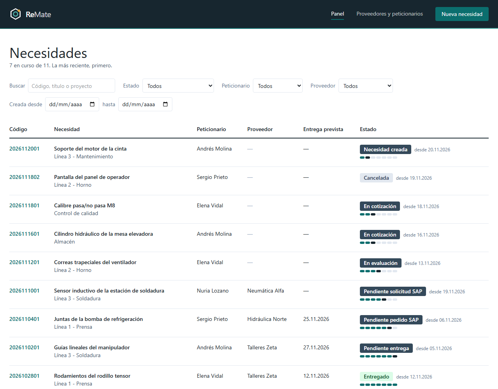

- Cada fila es una necesidad: código, título, proyecto, peticionario, proveedor adjudicado y fecha de entrega prevista.
- La columna **Estado** dice en qué paso está y **desde cuándo**. La barrita de colores debajo resume los 7 pasos: en rojo los hechos, en negro el que toca.
- **Filtros:** busca por código, título o proyecto, o filtra por estado, peticionario, proveedor adjudicado y fechas de creación. «Quitar filtros» los borra todos.
- Pulsa en el código o en el título para abrir la necesidad. Al volver con «Necesidades», el panel conserva los filtros.

**El código** de cada necesidad tiene la forma `AAAAMMDDNN`: la fecha de creación y un número de orden del día (por ejemplo, `2026102801`).

## 3. Paso 1: crear una necesidad

Pulsa **Nueva necesidad**, arriba a la derecha.

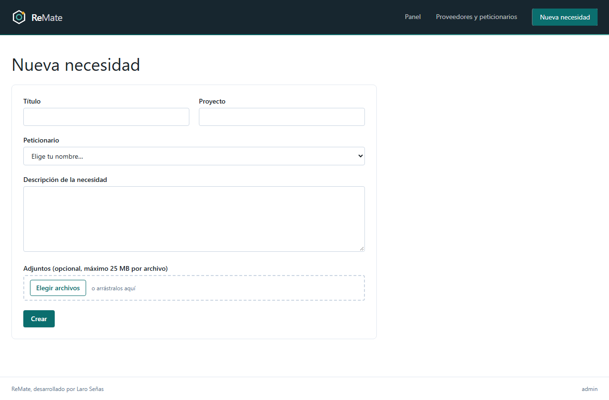

1. **Título:** qué se compra, en pocas palabras (por ejemplo, «Rodamientos del rodillo tensor»).
2. **Proyecto:** la línea, máquina o proyecto al que va.
3. **Peticionario:** tu nombre. Si no estás en la lista, puedes darte de alta desde aquí.
4. **Descripción de la necesidad:** qué hace falta, con **cantidades**, materiales, medidas o referencias. Es lo que usa la IA para redactar el correo a los proveedores: cuanto más clara, mejor sale.
5. **Adjuntos** (opcional): planos, fotos o fichas, hasta 25 MB por archivo. Pulsa «Elegir archivos» o arrástralos a la caja.
6. Pulsa **Crear**.

Al crearla se abre su pantalla de detalle, ya en el paso 2.

## 4. Paso 2: solicitar ofertas

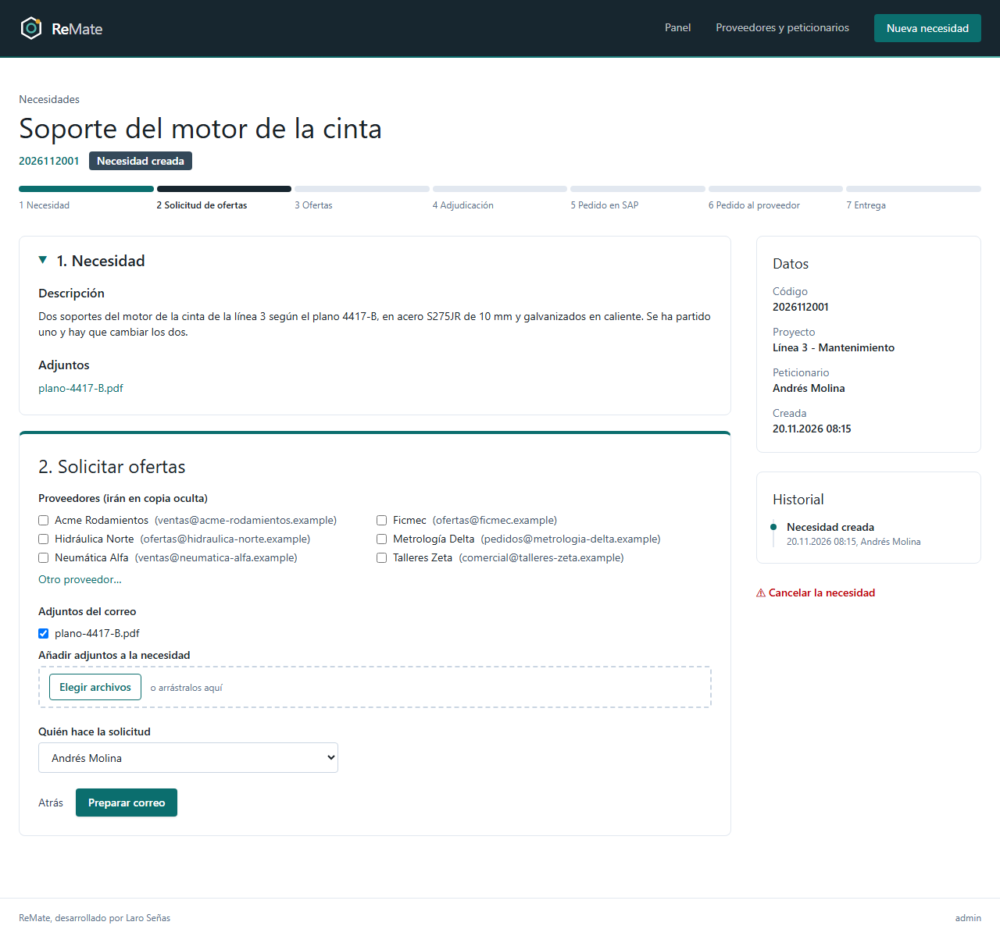

La pantalla de detalle es igual en todos los pasos:

- **Arriba**, el título, el código, el estado y la pista con los 7 pasos.
- **A la izquierda**, los pasos. Los ya hechos aparecen plegados: pulsa en su título para verlos. El que toca está abierto, con un borde rojo arriba.
- **A la derecha**, los datos de la necesidad y el **historial**: cada cambio de estado, con la fecha y quién lo hizo.

Al abrir una necesidad, la pantalla baja sola hasta el paso que toca.

Para pedir ofertas:

1. **Marca los proveedores** a los que quieres pedir oferta. Irán en **copia oculta**: ninguno ve a los demás. Si falta alguno, pulsa «Otro proveedor…», escribe su nombre y su correo, y guárdalo en la lista. Hay que pedir oferta a **3 proveedores como mínimo**; si marcas 1 o 2, escribe el **motivo** (por ejemplo, «ser el fabricante del equipo»). Debajo verás cómo irá en el texto para SAP: «Proveedor único por …» o «Solo 2 proveedores consultados por …».
2. **Adjuntos del correo:** marca los archivos de la necesidad que quieres enviar (normalmente, los planos). Si te falta alguno, añádelo aquí.
3. **Quién hace la solicitud:** tu nombre.
4. Pulsa **Preparar correo**. La IA redacta la parte central del correo a partir de la descripción. Si ve que falta algo (por ejemplo, la cantidad), pone `[INDICAR …]` en el texto y te avisa arriba.
5. **Revisa y corrige el texto** si hace falta.
6. Pulsa **Generar solicitud**. Se descarga el `.eml`: ábrelo con Outlook, comprueba que está todo y envíalo.

«Atrás» vuelve al paso 1, por si hay que corregir los datos de la necesidad.

La necesidad pasa a **En cotización**. El correo se puede volver a descargar desde el paso 2 plegado.

## 5. Paso 3: subir y revisar las ofertas

Cuando un proveedor conteste, sube aquí su correo.

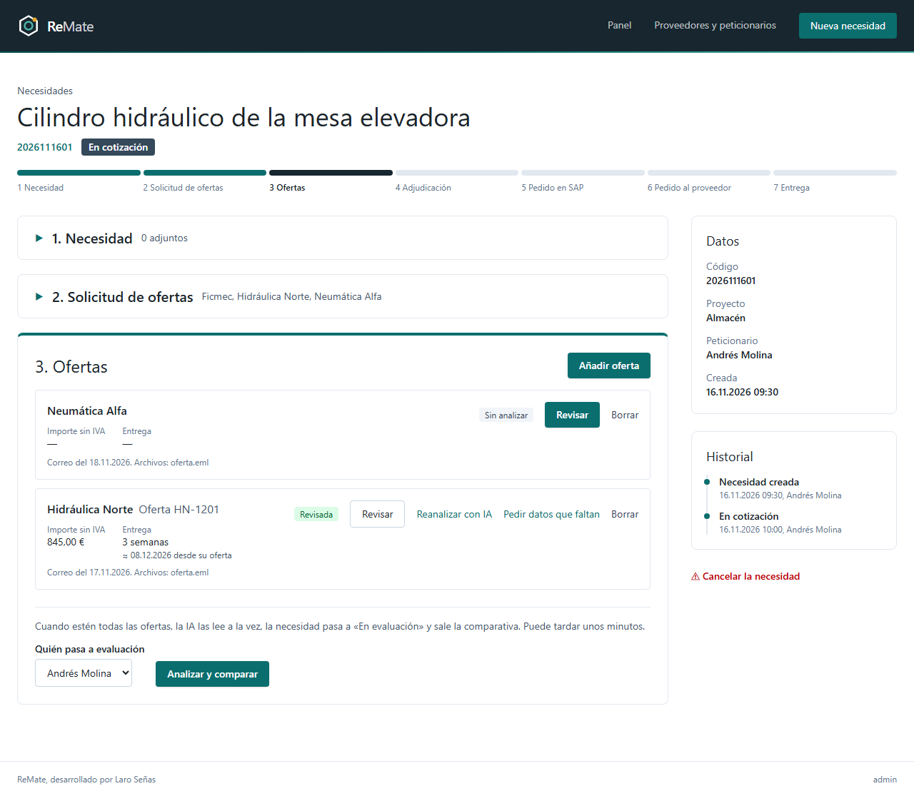

### Subir una oferta

1. Pulsa **Añadir oferta**.
2. **Correo de la oferta (.eml o .msg):** el correo del proveedor. Puedes arrastrarlo directamente desde Outlook a la zona del correo.
3. **Adjuntos que importan:** al elegir el correo, ReMate saca sus adjuntos y los muestra con la marca «(del correo)» y su tipo propuesto (PDF, Excel, Word, Imagen u Otro); los logos de la firma no salen. Cambia el tipo si hace falta y quita con «Quitar» los que no importen. Con «+» añades otros archivos. Si la oferta va en el propio cuerpo del correo, no hace falta ningún adjunto.
4. **Proveedor:** si ReMate lo reconoce por el correo del remitente o por su empresa (el dominio, la parte que va después de la @), ya sale elegido. Si no, déjalo en «Reconocerlo por el remitente del correo», elígelo de la lista o créalo. Cuando la oferta la envía otra persona de la empresa del proveedor, los correos de la adjudicación y del pedido van a las dos direcciones.
5. Pulsa **Subir oferta**. La oferta se guarda y queda **Sin analizar**: la IA todavía no la lee.

Sube así cada oferta según te llegue. **Cuando estén todas**, elige quién lo hace y pulsa **Analizar y comparar**: la IA lee todas las ofertas a la vez, la necesidad pasa a «En evaluación» y sale la comparativa. Puede tardar unos minutos. Si la IA no puede leer alguna, te avisa: vuelve a pulsar el botón o escribe sus datos a mano en «Revisar».

Si el proveedor manda **una oferta nueva** (una revisión con otro precio, por ejemplo), súbela igual. La aplicación avisa de que sustituye a la anterior, y la anterior se guarda en el historial.

### Revisar los datos

Cada oferta muestra el importe sin IVA (en ReMate todos los importes son sin IVA), la entrega y los archivos. Arriba de cada una dice **Sin analizar**, **Sin revisar** (la ha leído la IA) o **Revisada**.

1. Pulsa **Revisar** para abrir sus datos: número de oferta, importes, plazo y fecha de entrega, condiciones de pago, **otras condiciones** (embalaje, Incoterm, transporte, qué incluye el precio, validez, revisión por materia prima, utillaje, tratamientos y condiciones de pedido: cada una con su estado, como «No especificado», «Incluido» o «No incluido», y lo que dice la oferta), información adicional (por ejemplo, la garantía) y las **líneas** (descripción, cantidad, precio unitario sin IVA, entrega y, debajo, el plazo que dio el proveedor para esa línea, si lo dio).
2. **Comprueba todo con el PDF o el correo del proveedor y corrige lo que haga falta.** La IA ayuda, pero puede equivocarse. Si el proveedor solo dice un mes («entrega en diciembre»), ReMate pone de fecha el **último viernes de ese mes**; si sabes otra, cámbiala.
3. Pulsa **Guardar y dar por revisada**. Si aún no lo has comprobado todo, usa «Guardar sin revisar». Si algún dato no vale, la pantalla sube hasta el error para que lo corrijas. Al guardar, se cierra la revisión y la pantalla se queda en esa oferta. Si cierras la revisión con cambios sin guardar, la aplicación te pregunta antes de descartarlos.

**Pedir los datos que faltan:** si a una oferta le falta algo (el importe, la entrega, las condiciones de pago, las partidas o alguna de las otras condiciones), sale **Pedir datos que faltan**. ReMate prepara el correo al proveedor con la lista; revísalo, pulsa **Descargar el .eml**, ábrelo con Outlook y envíalo. Ese correo no se guarda en ReMate. Cuando conteste, sube su correo con **Añadir oferta**: como ese proveedor ya tiene oferta, ReMate te pregunta qué hacer; pulsa **Añadir datos del proveedor**. La IA lee su respuesta y actualiza la oferta: completa lo que faltaba y, si la respuesta dice algo distinto (por ejemplo, otro precio en una partida u otra fecha de entrega), lo cambia y te avisa de cada cambio. Si trae una partida que no estaba, la añade y te pide comprobar que no es una de las de antes con otro nombre. Lo que la respuesta no dice se queda como estaba. Después, revisa la oferta.

**Avisos:** debajo de cada oferta, en naranja, salen los datos que faltan o no cuadran. Por ejemplo, «Falta: fecha de entrega», o que la suma de las líneas no coincide con el total. También salen los avisos de la IA, que empiezan por «La IA avisa:» (por ejemplo, si la oferta solo da importes con IVA: entonces escribe tú el importe sin IVA).

**El plazo de entrega:** si el proveedor da una fecha concreta, se usa esa. Si da un plazo («3 semanas»), se muestra el plazo y, debajo, la fecha aproximada contando desde su correo, solo para comparar. Al adjudicar y al meter el pedido, ese plazo se cuenta desde ese día. Si el plazo es un rango («3-4 semanas»), se toma el número más alto. Si cada línea trae su propio plazo («18 - 20 días», «5 Sem.»), cada línea queda con su fecha y, si la oferta no da una fecha para toda ella, la de la oferta es la de la línea que más tarda: el pedido no está completo hasta que llega todo. Al adjudicar, el plazo de cada línea se cuenta desde ese día, y así sale en la tabla para SAP. Si cambias a mano la fecha de una línea, se queda la tuya. Si el proveedor da una semana del calendario («KW 50»), se toma el viernes de esa semana. Si la oferta trae un descuento como línea aparte, ReMate te avisa con su importe: las líneas no pueden ser negativas (tampoco en SAP), así que hay que repartirlo en los precios o pedir al proveedor los precios con el descuento aplicado.

**La moneda:** en «Revisar», al lado de cada precio (importes y precios unitarios) hay un desplegable pequeño con el símbolo de la moneda: €, $, £, zł, CHF o ¥. La oferta tiene una sola moneda, así que al cambiar uno cambian todos. Por defecto es el **euro**. La IA la rellena si la ve clara; si no, deja € y lo avisa («La IA no ha visto la moneda…»). Comprueba que coincide con la oferta antes de guardar. Los importes se muestran con su símbolo (por ejemplo, «4.636,00 €»).

**Ofertas en otro idioma:** la IA deja los datos en español; por ejemplo, «25 working days» pasa a «25 días laborables».

Otros botones de cada oferta:

- **Reanalizar con IA:** la IA vuelve a leer el correo y los adjuntos. Sustituye lo que hayas corregido a mano.
- **Borrar:** quita la oferta (por ejemplo, si se subió por error). Pide confirmación.

Si llega una oferta cuando la necesidad ya está «En evaluación», súbela igual y pulsa **Analizar las nuevas y volver a comparar**.

## 6. Paso 4: comparar y adjudicar

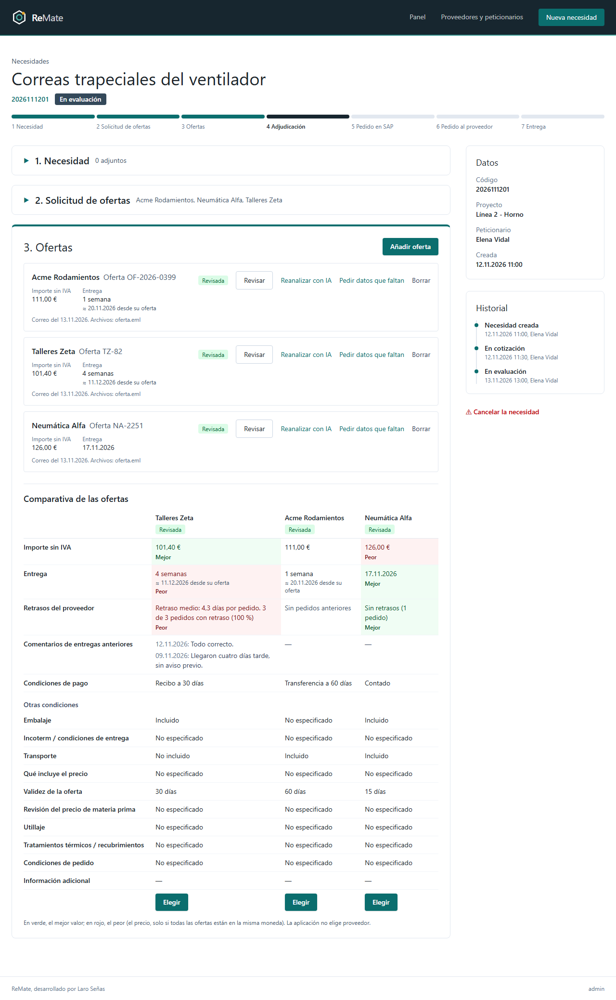

### La comparativa

Cada proveedor va en una **columna** y los datos en **filas**: importe sin IVA (con el símbolo de su moneda), entrega, los **retrasos del proveedor** en pedidos anteriores, condiciones de pago y otros. Lo que cuenta de los retrasos es el **retraso medio** por pedido, junto con cuántos pedidos se retrasaron (por ejemplo, «2 de 4 pedidos con retraso (50 %)»). El enlace abre su histórico en otra pestaña.

Salen también las ofertas que aún no has revisado, marcadas **Sin revisar**: son los datos que ha leído la IA. **Para elegir una oferta tienes que haber revisado todas** (botón **Revisar** de cada oferta): mientras falte alguna, la pantalla te dice cuáles y no aparece «Elegir».

**Monedas distintas:** ReMate no convierte importes. Si las ofertas vienen en monedas distintas, la comparativa lo avisa y el orden de la tabla (por importe sin IVA) no sirve: pásalas tú a la misma moneda para compararlas. Los precios para SAP se quedan en la moneda de la oferta.

- **Mejor y peor valor:** cuando están **todas las ofertas revisadas**, la tabla marca en **verde** («Mejor») el precio más bajo, la entrega más próxima y el menor retraso medio del proveedor, y en **rojo** («Peor») los contrarios. El precio solo se marca si todas las ofertas están en la misma moneda; un dato que falta no se marca como peor. Si llega otra oferta, las marcas se quitan hasta que la revises. Lo calcula la aplicación, sin IA, y **no elige**: la decisión es tuya.

### Adjudicar

1. Pulsa **Elegir** en la columna de la oferta que quieres. La pantalla baja hasta «Adjudicar a …».
2. La aplicación prepara, con ayuda de la IA:
   - **Avisos para revisar** (no impiden adjudicar). Si la oferta que eliges **no es la más barata** o **no es la que antes entrega**, la aplicación te lo dice con el proveedor que la mejora y la diferencia (por ejemplo, «No es la oferta más barata: Acme ofrece 40,00 EUR sin IVA (11,25 EUR menos). Explica en la descripción por qué se elige.»). Solo se compara con las ofertas revisadas, y el precio solo si están en la misma moneda. Explica el motivo en la descripción de la inversión.
   - **Texto para SAP:** las líneas fijas (`SOLICITADO POR:`, `IR: NO` y, si pediste oferta a menos de 3 proveedores, la del motivo) y, debajo, la **descripción de la inversión**, que puedes editar. Pulsa **Copiar el texto** para copiarlo entero y pegarlo en SAP.
   - **Tabla para SAP:** una fila por línea de la oferta, con las columnas y los formatos que pide SAP (Short Text, Quantity requested, Valuation Price, Delivery Date y Requisitioner). Pulsa **Copiar las filas** para pegarla.
   - **Correo al proveedor** comunicándole la adjudicación: revísalo y edítalo si hace falta.
3. **Quién adjudica:** tu nombre.
4. Pulsa **Confirmar la adjudicación**. Se descarga el `.eml` al proveedor: ábrelo con Outlook y envíalo.

Si una oferta tiene algo que lo impide (por ejemplo, no tiene líneas), sale en rojo y no deja confirmar. Si corriges la oferta mientras preparas la adjudicación, pulsa «Volver a preparar».

## 7. Paso 5: meter el pedido en SAP

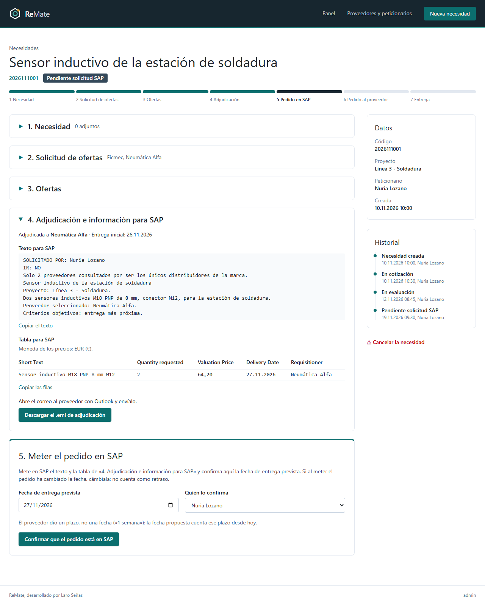

El paso 4 queda abierto con el **texto y la tabla para SAP**, para copiarlos mientras metes el pedido en SAP. El `.eml` de adjudicación se puede volver a descargar desde aquí.

1. Mete el pedido en SAP con ese texto y esa tabla (fuera de ReMate).
2. Comprueba la **fecha de entrega prevista** que propone la aplicación: la de la oferta o, si el proveedor dio un plazo, ese plazo contado desde hoy. Si al meter el pedido ha cambiado, corrígela: aquí no cuenta como retraso.
3. **Quién lo confirma:** tu nombre.
4. Pulsa **Confirmar que el pedido está en SAP**.

**Aviso a los avisados del pedido SAP:** al confirmarlo, ReMate envía un correo a las personas de la lista «Avisados del pedido SAP» (ver el apartado 11) para que hagan el pedido en SAP. Mientras no se envíe el pedido al proveedor (paso 6), se lo recuerda cada semana. En el paso 6 verás cuándo se les avisó por última vez; si no se ha podido avisar (por ejemplo, porque la lista está vacía), también lo dice, y ReMate lo vuelve a intentar cada mañana.

## 8. Paso 6: enviar el pedido al proveedor

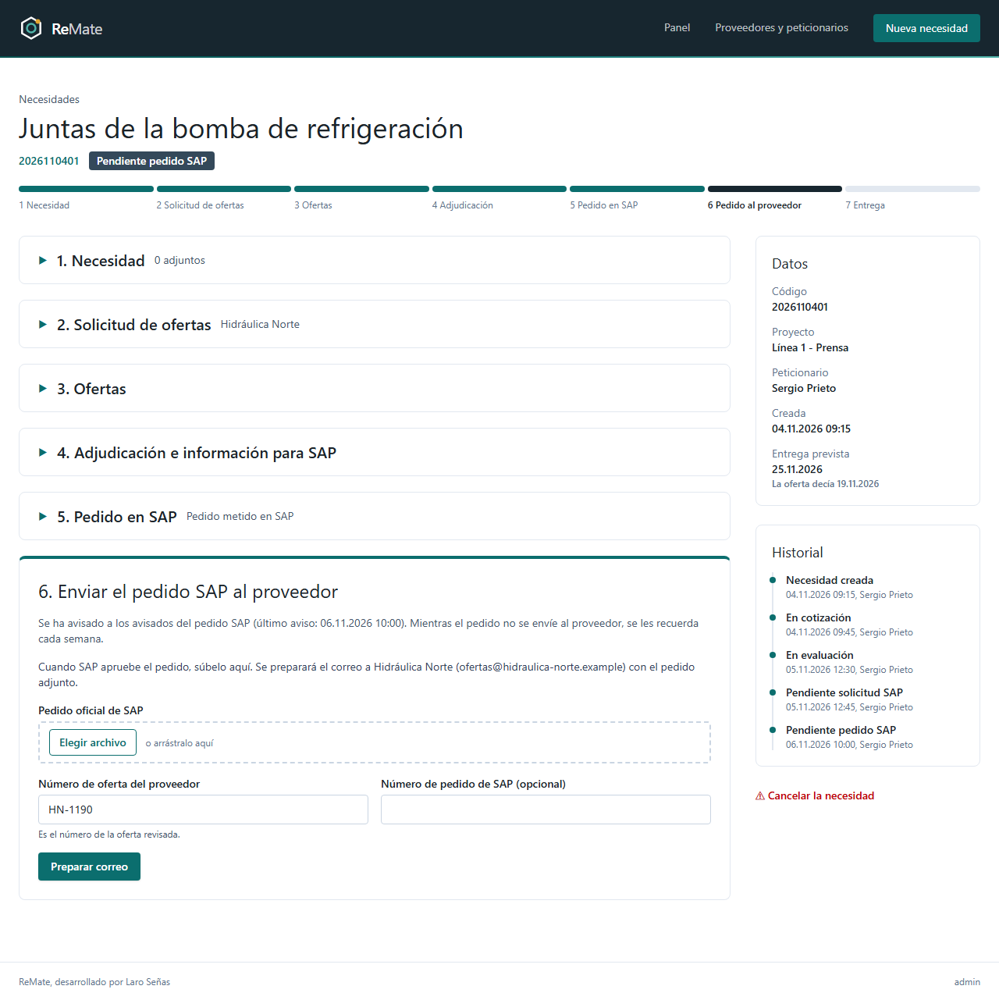

Cuando SAP apruebe el pedido:

1. **Pedido oficial de SAP:** sube el archivo del pedido (o arrástralo a la caja).
2. **Número de oferta del proveedor:** viene relleno con el de la oferta revisada; corrígelo si hace falta.
3. **Número de pedido de SAP** (opcional). Al elegir el PDF del pedido, ReMate lo lee del propio PDF (detrás de «PURCHASE ORDER NO.») y lo pone en el campo, con la nota «Leído del PDF del pedido: compruébalo». Si no lo encuentra, escríbelo tú.
4. Pulsa **Preparar correo**, revisa el correo al proveedor y pulsa **Generar el .eml**. Se descarga con el pedido adjunto: ábrelo con Outlook y envíalo.

La necesidad pasa a **Pendiente entrega**.

## 9. Paso 7: retrasos y entrega

Mientras la necesidad está en **Pendiente entrega**:

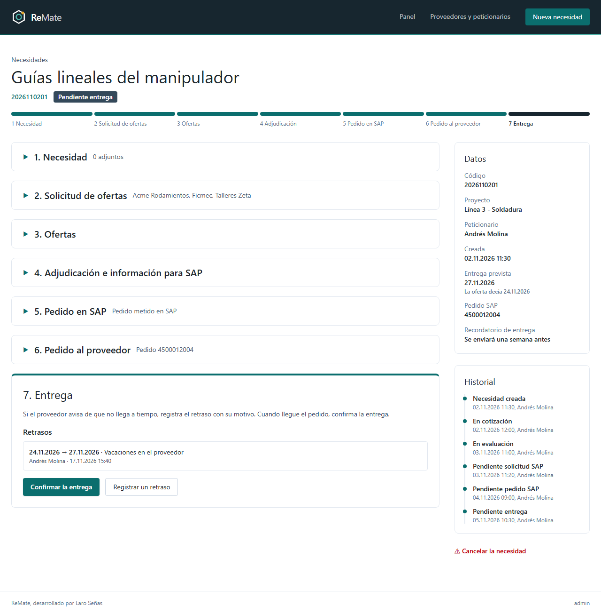

- **Registrar un retraso:** si el proveedor avisa de que se retrasa, indica la **nueva fecha de entrega**, el **motivo** y quién lo registra. La nueva fecha pasa a ser la prevista. Se pueden registrar varios retrasos.
- **Confirmar la entrega:** cuando llegue el pedido, indica la **fecha en que llegó** y quién lo confirma. Si llega más tarde de lo previsto, la aplicación pide el motivo del retraso. Si quieres, escribe un **comentario** sobre la entrega (por ejemplo, que el paquete llegó dañado o faltaba algo): se verá al comparar ofertas de ese proveedor más adelante, en su histórico, y lo tendrá en cuenta la IA al redactar la adjudicación. Antes de cerrar la necesidad, te pregunta si estás seguro, para evitar confirmarla por error.

**Recordatorio por correo:** una semana antes de la fecha de entrega prevista, ReMate envía un correo al peticionario para que compruebe con el proveedor que todo va bien. Lleva el proveedor, el número de pedido SAP y un enlace a la necesidad. Si se registra un retraso, el recordatorio se vuelve a enviar respecto a la nueva fecha.

Al confirmar la entrega, la necesidad pasa a **Entregado**, la pantalla vuelve arriba y el paso 7 queda para consultar, con la fecha de llegada y los retrasos.

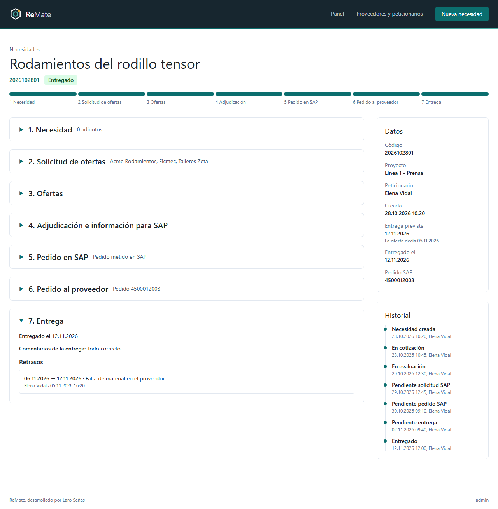

**Cómo cuentan los retrasos:** cuenta el retraso real. Si el pedido llega el día previsto o antes, los retrasos avisados se marcan «No se cumplió: llegó a tiempo» y no cuentan en el histórico del proveedor. Si llega tarde, cuentan los días entre la fecha prevista original y la de llegada.

## 10. Cancelar una necesidad

Si una necesidad ya no hace falta, pulsa **Cancelar la necesidad**, a la derecha, debajo del historial. Escribe el **motivo**, elige quién la cancela y pulsa «Confirmar la cancelación».

Una necesidad cancelada o entregada ya no admite cambios. Sigue en el panel con su historial y su motivo.

## 11. Proveedores y peticionarios

Se gestionan en **Proveedores y peticionarios**, en la barra de arriba. Ahí está también la lista **Avisados del pedido SAP**: quién recibe el correo cuando se mete en SAP la solicitud de compra (paso 5) y su recordatorio semanal. Se mantiene igual que las otras dos.

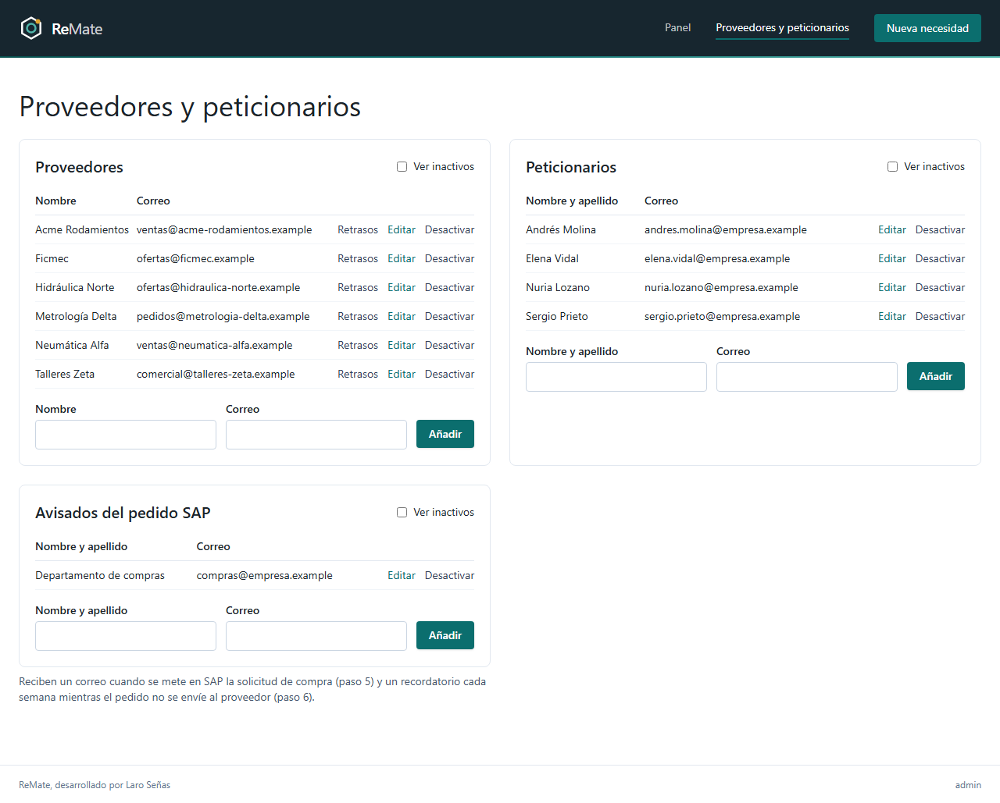

- **Añadir:** escribe el nombre y el correo y pulsa «Añadir». No puede haber dos con el mismo correo.
- **Editar:** cambia el nombre o el correo.
- **Desactivar:** deja de salir en las listas para necesidades nuevas, pero sigue en las antiguas. Para verlo, marca «Ver inactivos»; desde ahí se puede **reactivar**.
- **Eliminar definitivamente:** solo para registros ya desactivados, con un motivo (por ejemplo, «Dado de alta por error»). Deja de salir también en «Ver inactivos», pero sigue en las necesidades antiguas. No se puede deshacer. Si es un peticionario que lleva necesidades sin terminar, la aplicación te las enseña y te pide elegir quién las lleva a partir de ahora; queda anotado en el historial de cada una.
- **Retrasos** (proveedores): abre el histórico del proveedor: el retraso medio por pedido, cuántos pedidos tuvieron retraso (y qué proporción), cuántos se le han adjudicado y cada retraso, con su necesidad y su motivo. Debajo, los comentarios de las entregas de sus pedidos.

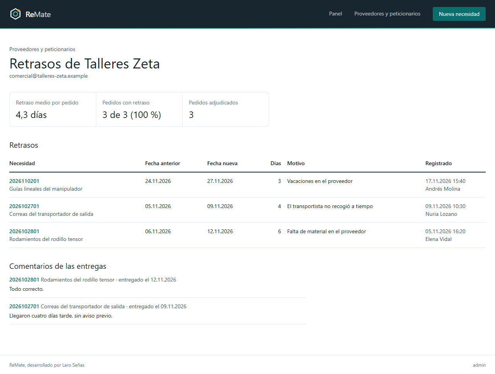

**Archivos antiguos:** para ocupar poco en el servidor, ReMate borra los archivos de las necesidades ya entregadas o canceladas: los de las ofertas, los correos y el pedido SAP a los 6 meses, y los adjuntos de la necesidad (planos) a los 2 años. La necesidad sigue con todos sus datos; donde estaba el enlace sale «eliminado por antigüedad: búscalo en Outlook o en SAP».

## 12. La ayuda de la IA

ReMate usa una IA (la de OpenAI) en tres momentos:

| Dónde | Qué hace |
| --- | --- |
| Paso 2 | Redacta el correo de petición de oferta a partir de la descripción |
| Paso 3 | Lee cada oferta (correo y adjuntos) y rellena sus datos |
| Paso 4 | Redacta la descripción para SAP y el correo de adjudicación |

La comparativa de las ofertas (paso 3) no usa la IA: el mejor y el peor valor los calcula la aplicación.

Lo que hay que saber:

- **La IA ayuda, pero no decide ni sustituye tu revisión.** Comprueba siempre los datos de cada oferta antes de darla por revisada, y el texto antes de enviarlo.
- **Sus avisos** («La IA avisa: …») señalan datos dudosos, que faltan o que no coinciden. Léelos; algunos sobrarán.
- **Si la IA no responde,** la aplicación avisa y te propone el texto con los datos que tiene: en el correo de petición, tu descripción tal cual (y te avisa si no dice cuántas unidades); en la adjudicación, una descripción con el título, el proyecto, tu descripción y el proveedor, que completas con el motivo de la elección. Los datos de las ofertas los escribes a mano en «Revisar». Se puede volver a intentar más tarde con «Reanalizar con IA» o «Volver a preparar».
- **Qué recibe la IA:** el título y la descripción de la necesidad, las ofertas de los proveedores y, al adjudicar, los comentarios de las entregas anteriores de esos proveedores. No escribas en la descripción ni en los comentarios datos que no deban salir de la empresa.

## 13. Preguntas frecuentes

**He pulsado «admin», abajo en el pie, y sale una página que pide una contraseña.**
Es el modo admin, solo para el responsable de la aplicación. Pulsa «ReMate» otra vez o «Panel» para volver; no cambia nada.

**El correo del proveedor no se sube: «No se ha podido leer el .msg».**
Algún correo de Outlook puede no leerse. Abre el correo en Outlook y usa «Archivo > Guardar como», con el tipo «.eml»; después súbelo.

**«No se ha reconocido al proveedor por el remitente».**
El correo viene de una dirección que no está en la lista. Elige el proveedor a mano en «Proveedor» o, si es nuevo, créalo desde el mismo formulario.

**Un archivo no se sube porque pesa demasiado.**
El límite es de 25 MB por archivo y de 100 MB entre todos los que subes a la vez (si pasas de ahí, súbelos en varias veces). Comprime el archivo o pide al proveedor una versión más ligera.

**La IA ha leído mal un dato.**
Pulsa «Revisar» en la oferta, corrígelo y guarda. Si prefieres que lo vuelva a leer, «Reanalizar con IA» (borra lo corregido a mano).

**No puedo confirmar la adjudicación.**
Mira el aviso en rojo: normalmente la oferta no tiene líneas o le falta la fecha de entrega. Corrígelo en la oferta y pulsa «Volver a preparar».

**Me he equivocado de proveedor o de oferta.**
Antes de confirmar la adjudicación, «Elegir otra oferta». Después, cancela la necesidad y créala de nuevo, o consulta al responsable de la aplicación.

**¿Dónde están los correos y archivos?**
Todo lo que subes y los `.eml` generados se guardan con la necesidad. Se descargan desde su paso, aunque esté plegado.

**El pie dice «Base de datos: error» o la aplicación no responde.**
Avisa al responsable de la aplicación o al equipo de sistemas.
